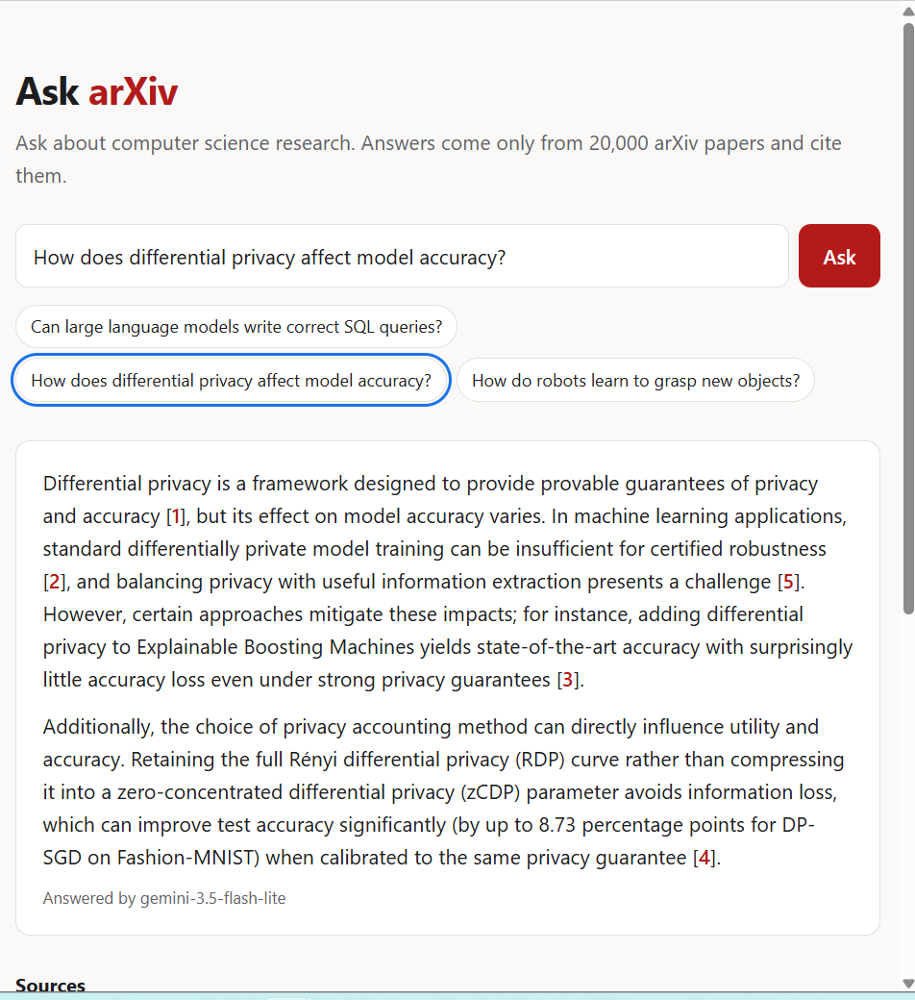

# Ask arXiv

**[Try it live](https://ask-arxiv-610310613353.us-east1.run.app)**: ask a question about computer science research and get a short answer that cites the papers it came from. If nobody has used it for a while, the first question takes about 15 seconds while the server starts.

Ask arXiv is a retrieval-augmented generation (RAG) app over 20,000 arXiv computer science papers. It finds the most relevant papers with hybrid search, then has Gemini answer using only those papers, with numbered citations that link to arxiv.org. If the papers don't answer the question, it says so instead of making something up.



## How it works

```
question ─► hybrid search over 20,000 papers ─► top 5 abstracts ─► Gemini ─► answer with [1] [2] citations
              ├─ keyword search (BM25)
              └─ meaning search (bge-small embeddings)
              combined with reciprocal rank fusion
```

1. **Finding papers.** Two searches run on every question.
   - **Keyword search (BM25)** is good at exact terms: model names, acronyms, rare words.
   - **Meaning search** turns the question and every paper into 384-number embeddings with [bge-small-en-v1.5](https://huggingface.co/BAAI/bge-small-en-v1.5) and finds the closest ones. It catches papers that use different words. For example, it found a paper that writes "oversmoothing" when the question said "over-smoothing", which keyword search treated as a different word.
   - **Reciprocal rank fusion** combines the two rankings. Each paper scores 1 / (60 + rank) from each list, so a paper near the top of both wins. It only uses ranks, so BM25 scores and cosine similarities never have to be put on the same scale.
2. **Answering.** The top 5 abstracts go to Gemini with instructions to use only those abstracts, cite every claim as [1] or [2, 4], and reply "The papers I found don't answer this." when they don't. Temperature is 0.2, to keep answers close to the sources.
3. **Checking the answer.** Any citation to a paper that wasn't given (like [7] when there were 5) is removed, so every link in an answer works. The page marks which sources were actually cited.
4. **Staying up.** The free Gemini models are sometimes overloaded. A busy model (503) or a used-up quota (429) is retried with exponential backoff, then the next model in the list takes over (3.5 Flash, then 3.5 Flash-Lite, then 3.1 Flash-Lite). Other errors, like a bad API key, fail straight away, because retrying won't help.

## How well does it work?

I built a test set of 199 questions. For 200 random papers, Gemini read the abstract and wrote one question that paper answers, without copying the title or using names the authors invented. Each question then has one known "right" paper. One question came back unusable and was dropped.

**Search** (`python evaluate.py`):

| Search | Recall@5 | MRR@10 |
|---|---|---|
| Keyword (BM25) | 96.0% | 0.927 |
| Meaning (embeddings) | 97.0% | 0.906 |
| **Hybrid** | **98.0%** | **0.959** |

Recall@5 is how often the right paper is in the top 5. MRR@10 rewards ranking it higher: 1 for first place, ½ for second, and so on.

**Answers** (`python evaluate.py --answers 50`):

| | |
|---|---|
| Cited the right paper, when search found it | 100% of 50 answers |
| Refused off-topic questions (recipes, sport, travel…) | 100% of 20 |

What the numbers say:

- **Hybrid is best on both measures.** Meaning search finds slightly more papers than keyword search, but keyword search ranks them higher when the question shares exact terms. Combining them gets the best of both.
- **The test is easier than real use.** The questions were written while reading the abstracts, so they reuse the abstracts' words, which is why keyword search alone scores 96%. Real users phrase things more loosely, so expect lower numbers in practice and a bigger advantage for meaning search. Also, only the paper a question came from counts as correct, even if another paper answers it too, so in that sense the scores are a lower bound.
- **A measurement bug I found:** the first run reported 90% refusals. When I looked at the two "failures", Gemini had refused both, but continued the sentence with a semicolon ("…don't answer this; instead…"), and my check required an exact match including the full stop. After fixing the check, refusals were 100%.

## Running it yourself

You'll need Python 3.10 or newer and a free [Gemini API key](https://aistudio.google.com/).

```bash
git clone https://github.com/PiyushaKadam07/Ask-arXiv.git
cd Ask-arXiv
pip install -r requirements.txt
export GEMINI_API_KEY=your-key

python search.py "graph neural networks over-smoothing"   # compare the three searches
python answer.py "can large language models write SQL?"   # one answer in the terminal
uvicorn app:app --port 8000                               # the web app at http://localhost:8000
pytest                                                    # 21 tests, no API key needed
```

The paper sample (`data/arxiv_sample.jsonl`) and its embeddings (`data/embeddings.npy`) are in the repo, so nothing needs rebuilding. To rebuild the embeddings, run `python build_index.py`. It took almost 2 hours on a 2-core Codespace.

| Endpoint | What it does |
|---|---|
| `GET /` | The question page |
| `POST /ask` | Takes `{"question": "..."}` (3 to 300 characters), returns the answer, the 5 sources, which ones were cited, the model used, and whether it was a refusal |
| `GET /health` | Status and number of papers |

Each visitor can ask 10 questions a minute, to protect the free Gemini quota.

## Deployment

The app runs on Google Cloud Run. The Docker image includes the papers, the embeddings and the embedding model, so a cold start doesn't download anything. The Gemini key is stored in Secret Manager and passed to the server as an environment variable when it starts. It never appears in the code, the image or this repo.

```bash
gcloud run deploy ask-arxiv --source . --region us-east1 --allow-unauthenticated \
  --cpu 1 --memory 2Gi --min-instances 0 --max-instances 1 \
  --set-secrets GEMINI_API_KEY=gemini-api-key:latest
```

`--min-instances 0` means it costs nothing when nobody is using it. `--max-instances 1` caps the cost and keeps the rate limiter accurate, since every visitor reaches the same server.

## Project structure

```
search.py          keyword, meaning and hybrid search
build_index.py     computes the paper embeddings (run once)
answer.py          prompt, Gemini call with retries and fallback, citation checks
app.py             FastAPI server: page, /ask, /health, rate limiting
static/index.html  the question page
make_questions.py  builds the test set with Gemini (structured JSON output)
evaluate.py        recall@5, MRR, citation and refusal rates
data/              20,000 papers, their embeddings, the test questions and results
tests/             21 tests with a tiny fake index and a fake LLM
```

## Limitations

- It only knows the 20,000 papers in the sample, and only their titles and abstracts, not the full text.
- Answers depend on the free Gemini tier, which can be slow or busy at peak times.
- The rate limiter lives in the server's memory. That works with one instance, but more instances would need a shared store like Redis.
- The test questions were generated by an LLM from the abstracts, so they are easier than real questions (see above).

## Related project

The paper sample comes from my [Hybrid Indexing](https://github.com/PiyushaKadam07/Big-data-Hybrid-Indexing) project, a distributed BM25 search engine over the same 20,000 papers.

arXiv metadata is released under CC0. Code under the MIT license.

Built by **Piyusha Kadam** · [GitHub](https://github.com/PiyushaKadam07)
